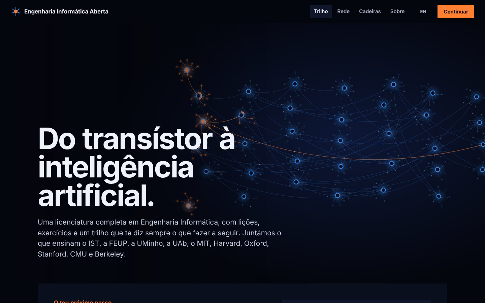
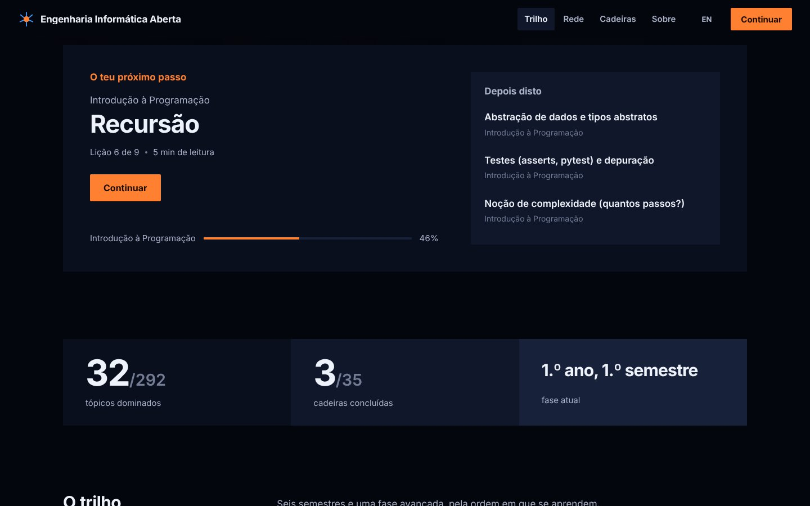
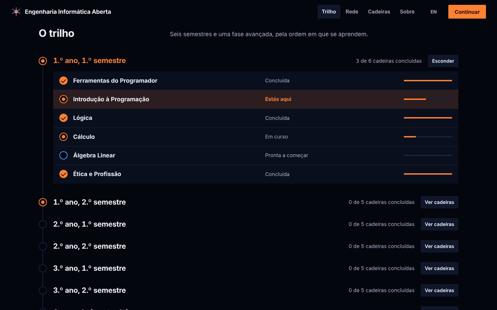
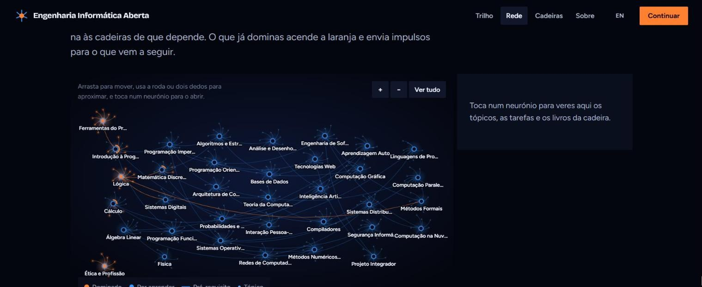
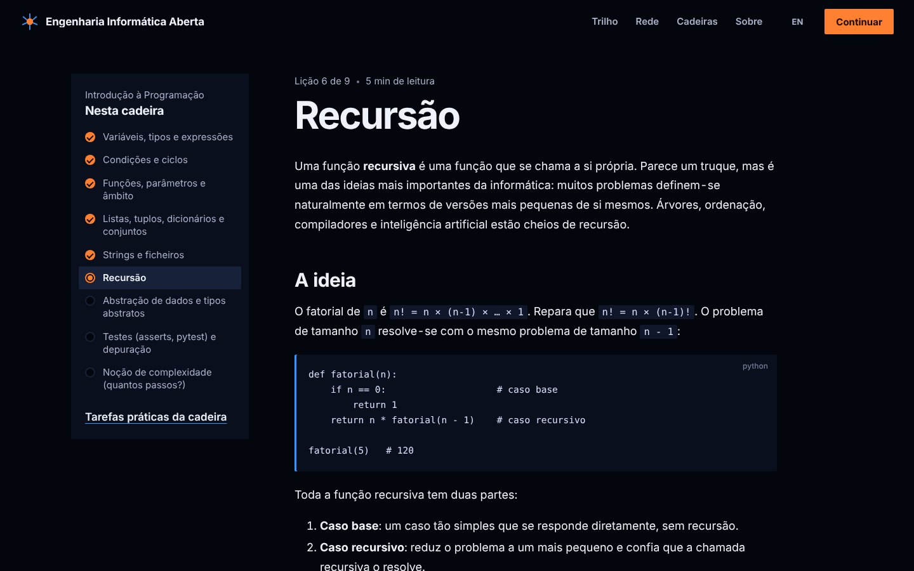
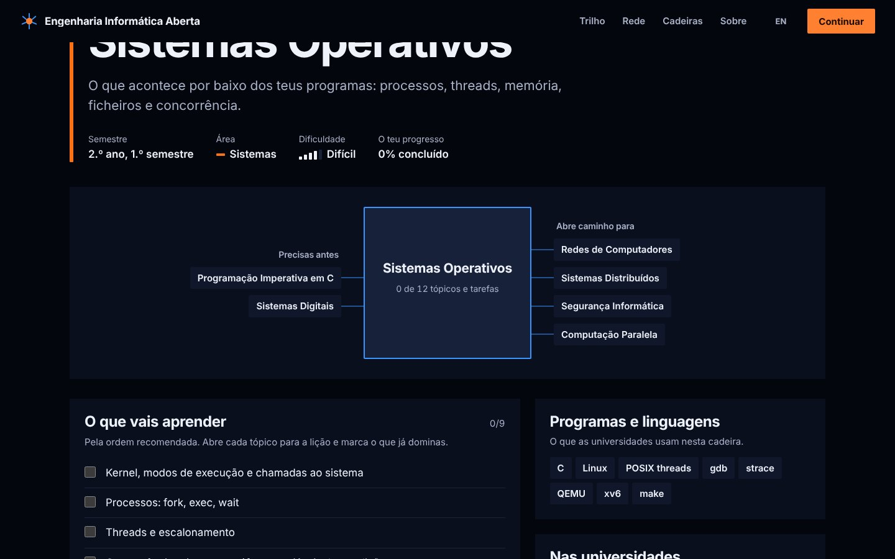
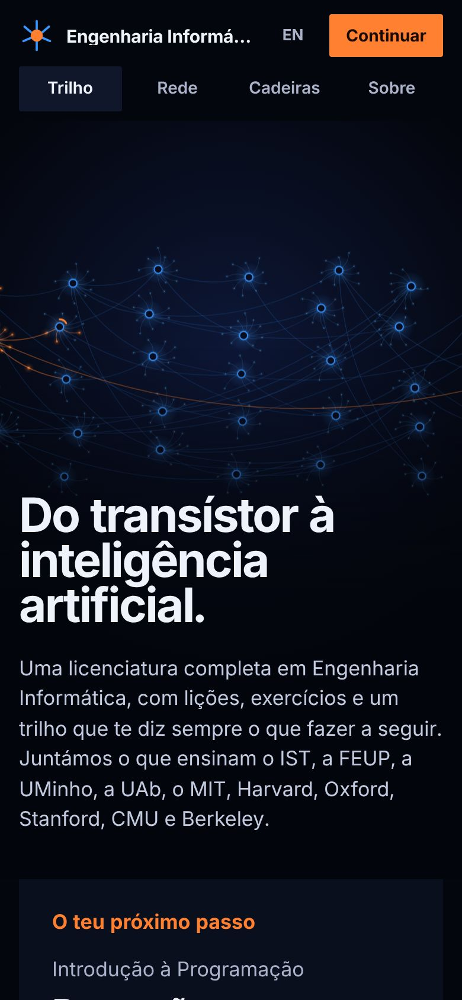
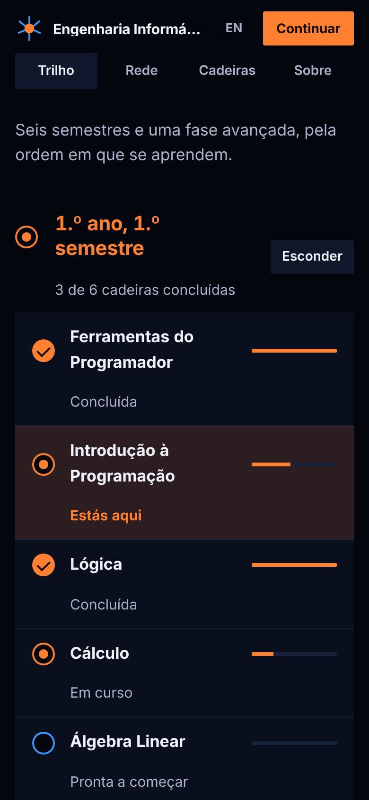

# Engenharia Informática Aberta

Um curso de **Engenharia Informática completo e gratuito**, em português e inglês. Não é só uma lista de links: tem **lições escritas**, **exercícios resolvidos**, um **trilho guiado** que te diz sempre o que fazer a seguir e uma **rede neural** que acende à medida que aprendes.

Cada cadeira junta o que ensinam o **IST, FEUP, UMinho, Universidade Aberta, MIT, Harvard, Oxford, Stanford, CMU e Berkeley**.

**Site:** [joaoantunesss.github.io/open-computer-engineering](https://joaoantunesss.github.io/open-computer-engineering/)

## O que tem

- **Trilho guiado.** O botão *Continuar* e o painel *O teu próximo passo* levam-te sempre à lição seguinte. O curso está dividido em fases (seis semestres e uma fase avançada) e cada cadeira mostra o seu estado: concluída, em curso, pronta a começar ou à espera de pré-requisitos.
- **Rede neural do curso.** Cada cadeira é um neurónio, os tópicos são as dendrites e os pré-requisitos são as sinapses. O que já dominas acende cor de fogo e envia impulsos para as cadeiras seguintes. Dá para arrastar, aproximar e abrir qualquer cadeira.
- **Lições completas.** Explicação, exemplos de código, erros comuns e exercícios com a solução escondida até a abrires. Já escritas: *Ferramentas do Programador* (terminal, shell, editores, Git, GitHub, SSH, depuração, Markdown e LaTeX) e *Introdução à Programação* (de variáveis a recursão, tipos abstratos, testes e complexidade).
- **35 cadeiras, 292 tópicos e 112 tarefas práticas**, do 1.º ano ao mestrado.
- **Programas e linguagens** usados em cada cadeira, e **livros e cursos gratuitos e legais** (MIT OpenCourseWare, CS50, OSTEP, Crafting Interpreters, …).
- **Equivalências entre universidades**: em cada cadeira, a cadeira correspondente em cada universidade, com ligação ao plano de estudos.
- **O teu progresso** fica guardado no browser, com exportação e importação para mudares de computador.
- **Pesquisa e filtros** por semestre, área, dificuldade e estado.

 

 

  

## Publicar no GitHub Pages

1. **Settings → Pages → Build and deployment → Source: Deploy from a branch**.
2. Ramo `main`, pasta `/ (root)`, **Save**.
3. Em um ou dois minutos o site fica em `https://<utilizador>.github.io/open-computer-engineering/`.

## Correr localmente

    python3 -m http.server 8000      # depois abre http://localhost:8000

Não há dependências nem passo de compilação: é HTML, CSS e JavaScript simples.

## Escrever lições

Cada lição é um ficheiro Markdown em `conteudo/<id-da-cadeira>/<n>.md`, onde `n` é o número do tópico, a contar de 1. Os blocos `??? Soluções` … `???` ficam escondidos até o leitor os abrir. Depois de editar, corre:

    node scripts/build-lessons.mjs

que gera `js/lessons.js`.

## Estrutura

    index.html            página única (rotas com #/)
    style.css             todo o design
    js/data*.js           as 35 cadeiras: tópicos, tarefas, programas, livros e equivalências
    js/lessons.js         lições (gerado a partir de conteudo/)
    js/rede.js            a rede neural (Canvas 2D, sem bibliotecas)
    js/app.js             trilho, páginas, progresso e pesquisa
    conteudo/             lições em Markdown
    docs/                 capturas de ecrã deste README

## Fontes

Os nomes das cadeiras de cada universidade vêm dos planos de estudos oficiais (ligações na página *Sobre* do site). Os planos mudam de ano para ano: confirma sempre no site da universidade. Os livros e cursos ligados pertencem aos seus autores; este projeto só os organiza e liga.

Tipos de letra: Bricolage Grotesque, Figtree e JetBrains Mono (SIL Open Font License), servidos pelo Google Fonts.
